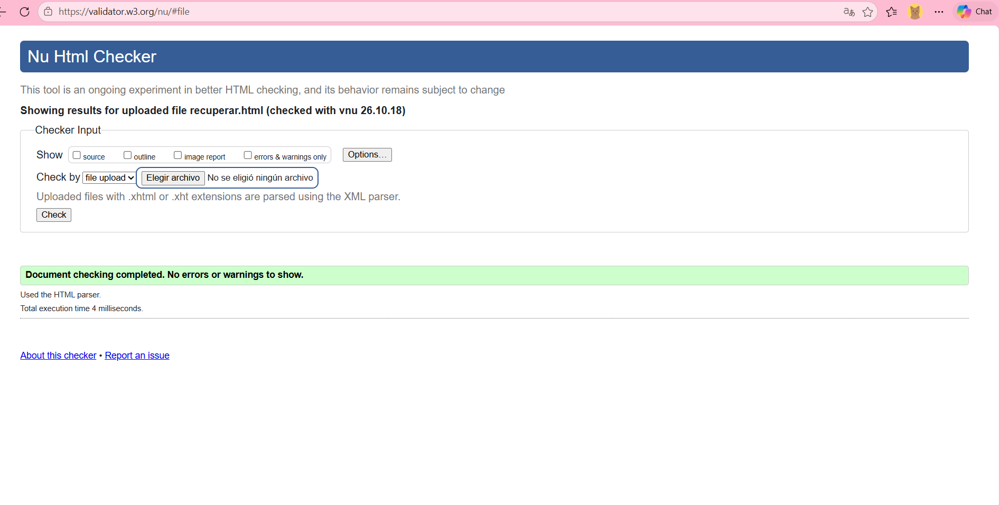
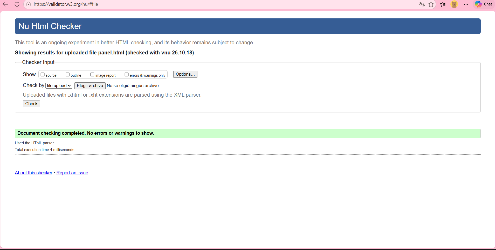
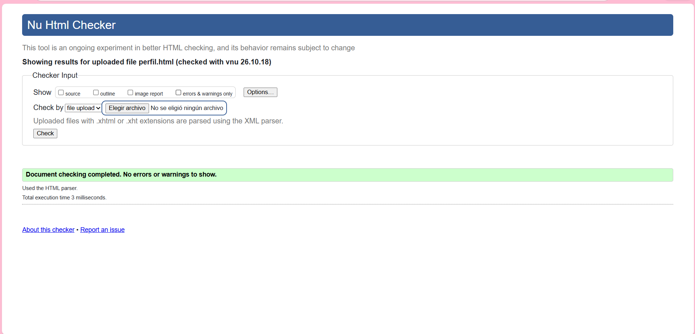
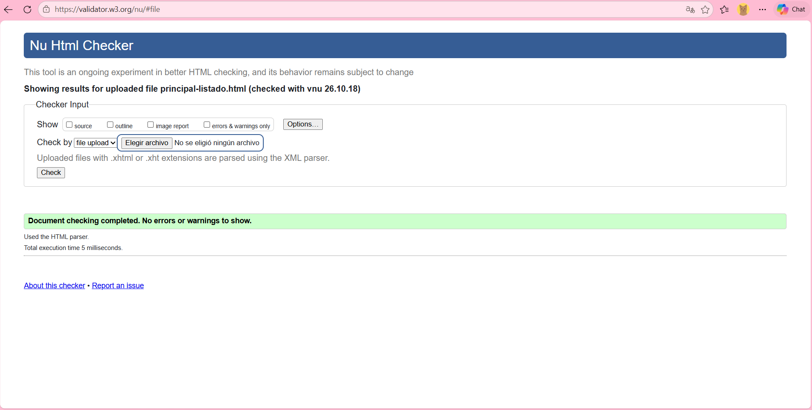
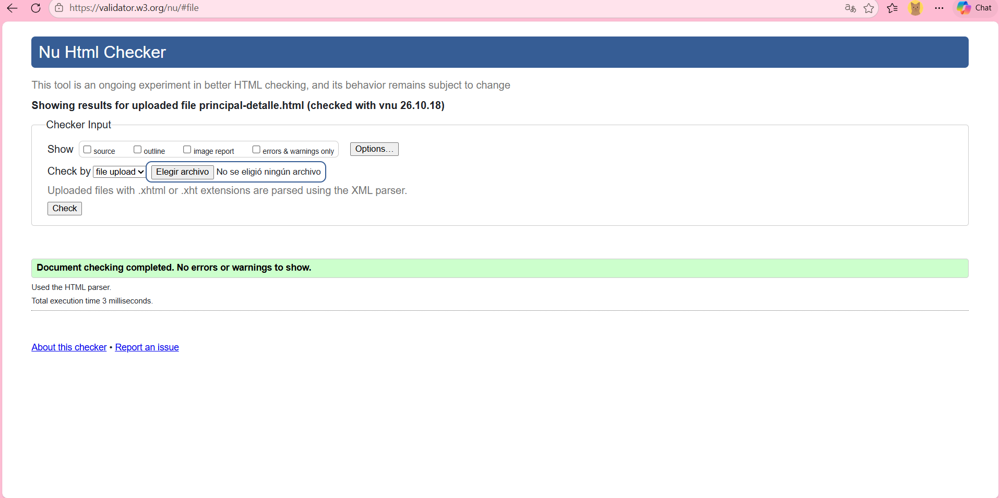

# CoSpace

Equipo 01 · Desarrollo Web · Hito #1

## Integrantes y roles del hito

| Integrante | Usuario GitHub | Rol |
|------------|----------------|-----|
| Moisés Perez | MPDF18 | Líder de proyecto y repositorio; Desarrollo (formularios) |
| Boris Guerra | borisguerra507martinez | Diseño y experiencia de usuario (wireframes, guía de estilo y CSS) |
| Walter Aparicio | Waparicio24 | Calidad, seguridad y documentación (README, usabilidad y validación) |

## Descripción

CoSpace es un sistema web para un coworking pequeño que permite reservar puestos flexibles, oficinas privadas, salas de reuniones y la terraza, evitando reservas duplicadas y controlando las horas usadas por cada miembro.

## Cómo abrir el sitio

Abrir `index.html` en el navegador.

## Personalización asignada

- **Prefijo:** `eq01-`
- **Color de acento:** `#6A1B9A`
- **Campo especial:** código de reserva (2 letras, guion y 4 números, ej. `CS-0123`)
- **Regla de negocio:** las salas de reuniones se reservan en bloques de 1 hora, de 8:00 a.m. a 8:00 p.m., con un máximo de 4 horas por miembro por día. El bloque, el horario y el máximo son parámetros configurables.

## Validación W3C

### CSS

### HTML

## Declaración de herramientas

| Herramienta | Uso |
|-------------|-----|
| Visual Studio Code | Editor de código |
| Git y GitHub | Control de versiones, ramas y Pull Requests |
| Validadores del W3C | Validación de HTML y CSS |
| Claude (Anthropic) | Asistente de inteligencia artificial, con los usos que se detallan abajo |

### Uso de inteligencia artificial (Claude)

- **Fase inicial:** guio con preguntas la definición del alcance del kickoff (contexto, roles, módulos, entidades y exclusiones), a partir de las decisiones del equipo.
- **Explicaciones:** uso de Git y GitHub (clonar, ramas, commits y Pull Requests), estructura de HTML5, semántica, tablas, formularios y CSS (selectores, Flexbox y media queries).
- **Revisión:** revisó las páginas HTML y la hoja de estilo, y señaló errores que corregimos (etiquetas sin cerrar, `for` e `id` que no coincidían, falta del prefijo, títulos repetidos).
- **Código de ejemplo:** propuso el encabezado y el menú (`index.html`), el contenido de `perfil.html`, las reglas de reserva de `panel.html`, la tabla y el buscador de `principal-listado.html`, el contenido de `principal-detalle.html` y los estilos de `css/estilos.css`. Los integrantes los escribieron, los probaron y los adaptaron.
- **Documentos e imágenes:** propuso la paleta, las tipografías y los estilos de la guía de estilo, calculó los contrastes y generó `docs/guia_estilo.pdf`; unió en `docs/wireframes.pdf` los bocetos dibujados a mano por el equipo; y generó `img/logo.png` e `img/plano.png`.
- **No usamos IA para:** la entrevista, la prueba de usabilidad ni sus resultados, que se hicieron con personas reales.